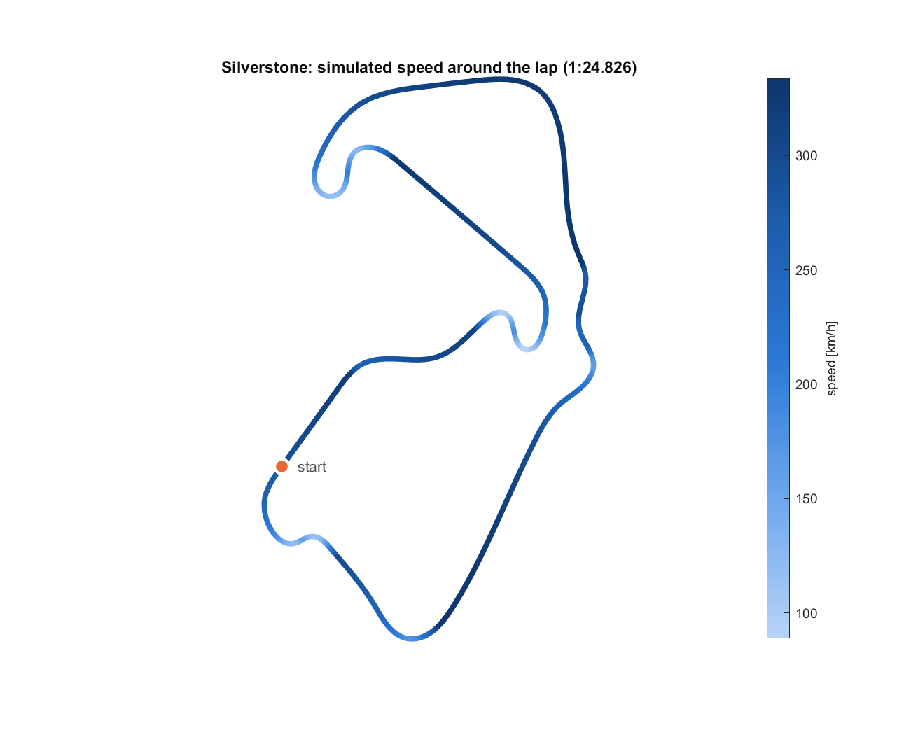
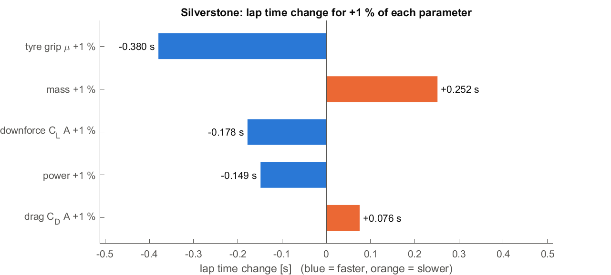
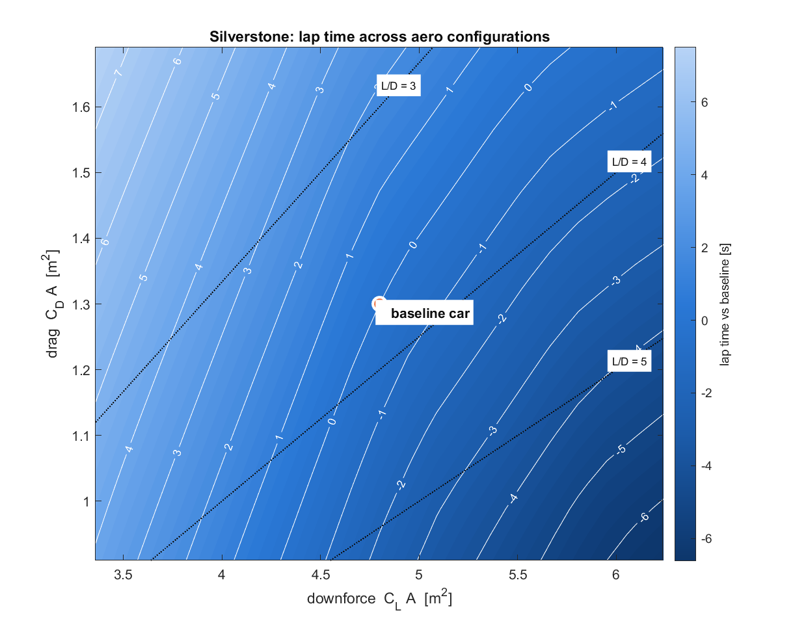
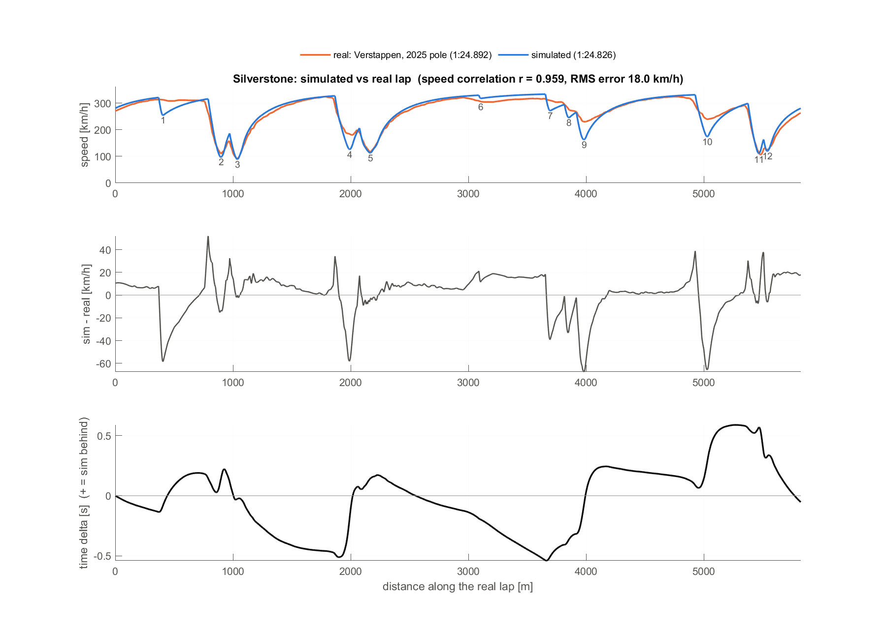

# Lap Time Simulator: 2025 F1 car at Silverstone (MATLAB)

  

A quasi-steady-state lap time simulator, written from scratch in MATLAB, that answers the
question race engineers and aerodynamicists ask every day: **how much lap time is a change to the car worth?**

It simulates an estimated 2025-spec Formula 1 car around Silverstone's racing line, measures the
lap time value of mass, power, tyre grip, downforce and drag, and is **validated against
Max Verstappen's real 2025 pole lap telemetry**.



## Key results

| Result (Silverstone) | Value |
|---|---|
| Simulated lap | **1:24.826** vs 2025 pole 1:24.892 (tyre grip calibrated to the pole time) |
| +10 kg of mass | **+0.31 s** per lap, inside the 0.3–0.4 s paddock rule of thumb ([The Race](https://www.the-race.com/formula-1/how-much-is-red-bulls-f1-weight-disadvantage-costing-it/)) |
| +0.1 m² of downforce (CL·A) | **−0.37 s** per lap |
| +0.1 m² of drag (CD·A) | **+0.58 s** per lap |
| Break-even L/D for a new aero part | **1.56**: a part that adds downforce at a better ratio to drag than this makes the car faster here |
| Speed trace vs real pole lap | correlation **r = 0.959**; the error is concentrated in the medium and high-speed corners (see [Validation](#validation-against-real-telemetry)) |

## What each parameter is worth



Tyre grip moves lap time the most because it acts in every corner and every braking zone.
Per percent, extra mass costs more than extra power gains.



Each contour is lap time relative to the baseline car over a ±30 % grid of downforce and drag.
Following any line of constant L/D towards more downforce still gets faster, so at Silverstone
downforce is worth having even when drag rises in proportion.

## Validation against real telemetry

`run_validation.m` downloads Verstappen's 2025 Silverstone pole lap from the free
[OpenF1 API](https://openf1.org/docs/), integrates the speed samples into distance, lines the
two laps up by best match of their speed traces, and compares them corner by corner.



| Corner | Sim min speed [km/h] | Real min speed [km/h] | Sim − real |
|---|---:|---:|---:|
| Abbey | 254 | 309 | −55 |
| Village | 97 | 110 | −13 |
| The Loop | 89 | 89 | 0 |
| Brooklands | 126 | 180 | −54 |
| Luffield | 113 | 116 | −3 |
| Copse | 317 | 304 | +13 |
| Maggotts | 271 | 305 | −34 |
| Becketts | 245 | 271 | −26 |
| Chapel | 163 | 230 | −67 |
| Stowe | 174 | 239 | −65 |
| Vale | 111 | 106 | +5 |
| Club | 119 | 121 | −2 |

Real speed data arrives at about 3.7 samples per second, so real minimum speeds can read slightly high.

**What the comparison shows**

- **Slow corners match well.** The Loop, Luffield, Vale and Club are within 5 km/h, Village within 13 km/h.
- **Medium and high-speed corners are 26–67 km/h too slow** (Abbey, Brooklands, Maggotts–Becketts–Chapel, Stowe),
  and the sim is 5–20 km/h too fast on most straights. Tuning grip to the pole time traded one error for the other.
- **The racing line is the main cause, not the car.** At those corners, the real speeds on the dataset's racing line
  would need 5–7.5 g of cornering (Abbey: 309 km/h on a 100 m radius is about 7.5 g), so the real car must be
  driving a wider, faster line than the dataset's.
- **Re-fitting the car confirms it.** `run_calibration.m` fits μ, CL·A and CD·A to the real trace (fminsearch).
  The best fit (μ 1.83, CL·A 5.45 m², CD·A 1.56 m²) only lowers the RMS speed error from 18.0 to 14.3 km/h,
  so most of the error comes from geometry the car parameters cannot fix.

## How it works

The car is a point mass with a mass, an engine power, a tyre friction coefficient and two aero
coefficients. At every metre the car is assumed to be in balance (quasi-steady-state).

**1. Track curvature.** A spline through the racing line is resampled every 1 m and its curvature κ = 1/R
is computed, then lightly filtered (5 m Gaussian) because double derivatives amplify noise in measured coordinates:

```math
\kappa = \frac{x' y'' - y' x''}{\left(x'^2 + y'^2\right)^{3/2}}
```

**2. Tyre load grows with speed.** Downforce adds to weight, so grip per kilogram rises with v²:

```math
n(v) = g + \frac{\rho \, C_L A \, v^2}{2m}
```

**3. Cornering speed limit.** At the limit, all lateral grip supplies the centripetal acceleration:

```math
v^2 |\kappa| = \mu_y \, n(v) \quad\Longrightarrow\quad v_{\text{apex}} = \sqrt{\frac{\mu_y \, g}{|\kappa| - \mu_y \rho C_L A / 2m}}
```

**4. Friction ellipse.** Grip is shared between cornering and accelerating or braking:

```math
a_{x,\text{grip}} = \mu_x \, n \sqrt{1 - \left(\frac{a_y}{\mu_y \, n}\right)^2}, \qquad a_y = v^2 \kappa
```

**5. Forward pass (accelerate)** with whichever is smaller, grip or power, minus drag and rolling resistance:

```math
a_x = \min\left(a_{x,\text{grip}},\ \frac{\eta P}{m v}\right) - \frac{\rho \, C_D A \, v^2}{2m} - C_{rr} \, n,
\qquad v_{i+1}^2 = v_i^2 + 2 a_x \Delta s
```

**6. Backward pass (brake).** The same integration run in reverse finds every braking point; drag helps here.

**7. Lap time.** The car's speed is the lowest of the three limits, and

```math
t_{\text{lap}} = \sum_i \frac{2 \, \Delta s}{v_i + v_{i+1}}
```

The MATLAB implementation was cross-checked against an independent Python implementation of the same model:
both give 1:24.826.

## Repository structure

```
lap-time-sim/
├── run_lap.m             Simulate one lap: lap time, peak g, plots, per-metre CSV
├── run_sensitivity.m     Parameter sensitivities, break-even L/D, downforce/drag map
├── run_validation.m      Compare with Verstappen's 2025 pole lap (OpenF1 telemetry)
├── run_calibration.m     Fit grip, downforce and drag to the real lap
├── cars/
│   └── car_f1_2025.m     Vehicle parameters (estimates)
├── src/
│   ├── load_track.m      Racing line -> evenly spaced points + curvature
│   ├── apex_speed.m      Cornering speed limit
│   ├── simulate_lap.m    Forward/backward passes, lap time
│   ├── get_openf1_lap.m  Download and cache a real lap from OpenF1
│   ├── compare_to_telemetry.m  Align sim and real laps, corner table, time delta
│   └── plot_*.m          Figures
├── data/tracks/          Silverstone and Monza racing lines (TUMFTM, LGPL-3.0)
└── results/              Plots and CSVs produced by the scripts
```

## Running it

Requires base MATLAB only (developed in R2024b; no toolboxes).

1. Set MATLAB's Current Folder to this repository.
2. Run `run_lap.m`. The Command Window shows `Lap : 1:24.826` and plots are saved to `results/`.
3. Run `run_sensitivity.m` for the parameter study and aero map (441 laps).
4. Run `run_validation.m` to download the real lap (internet needed the first time; cached in `data/telemetry/`) and compare.
5. Run `run_calibration.m` to fit μ, CL·A and CD·A to the real lap.

To try another car, copy `cars/car_f1_2025.m`. To try Monza, change the track settings at the top of `run_lap.m`.

## Limitations and next steps

- **Racing line from real data.** Build the line from the real car's position data (OpenF1 `location`) instead of the
  dataset line, then re-run the calibration. This targets the largest error found above.
- **Tyre and vehicle model.** Load-sensitive grip, front and rear axles, load transfer and aero balance
  (the point mass reaches about 7 g, more than a real car).
- **Aero.** Ride-height sensitivity and DRS are not modelled; the 2025 car parameters are estimates.
- **Front-wing CFD link.** Feed downforce and drag changes from an OpenFOAM front-wing study into the sensitivity model
  to quote a wing design in seconds per lap.

## Data and credits

- Racing lines: [TUMFTM racetrack-database](https://github.com/TUMFTM/racetrack-database), LGPL-3.0
  (licence in `data/tracks/LICENSE_racetrack-database`).
- Telemetry: [OpenF1](https://openf1.org/), downloaded on demand and not redistributed here.
- Reference times: 2025 British GP qualifying, Verstappen 1:24.892 ([FIA](https://www.fia.com/news/f1-verstappen-takes-superb-silverstone-pole-ahead-mclarens)).

## Author

**Shourya Patel**, Physics (Mechanical Engineering minor), Stony Brook University
[LinkedIn](https://www.linkedin.com/in/shourya-patel05) · [GitHub](https://github.com/Xerette)
